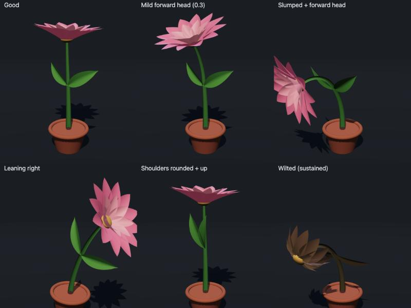

# Posture Flower

Real-time sitting-posture tracking from a laptop's front webcam (MediaPipe Pose Landmarker, heavy),
rendered as a 3D flower (three.js) that mirrors your body.



## Run

No build step: three.js and MediaPipe load from a CDN. Serve the folder and open it in Chrome:

```bash
python3 -m http.server 8785
```

Open http://localhost:8785, press **Start camera**, sit tall, and press **Calibrate**.
Camera frames stay in the browser. The MediaPipe library does send usage metrics to Google (see its README).

URL options: `?model=heavy|full|lite`, `?hz=15` (inference rate), `?tau=45` (seconds for flower health to respond),
`?src=front-man&autocal=1` (run on a test photo instead of the webcam).
`bench.html` benchmarks the three models on the test photos.

## Layout

| file | role |
|---|---|
| `src/pose.js` | PoseLandmarker wrapper (VIDEO mode, GPU delegate) |
| `src/posture.js` | landmarks → frontal features → One Euro filter → calibrated severities |
| `src/flower.js` | procedural flower; springs on every parameter |
| `src/main.js` | camera, calibration, inference timer, UI |

## Body → flower

| posture dimension | frontal-camera signal | flower |
|---|---|---|
| Trunk slump / recline (spine ⟂ thighs) | shoulders sink + get nearer the camera | stem bends forward/back as a C-curve |
| Ear–shoulder–hip stack | hips aren't visible, so inferred from head + trunk | (combined) |
| Side balance (weight) | shoulder-line tilt + sideways shift | stem leans, pot tips |
| Forward head | ear-above-shoulder height ÷ shoulder width shrinks; head grows relative to shoulders; 3D ear-vs-shoulder depth | top of stem nods, bloom droops; head roll tilts the bloom |
| Shoulders protracted / raised | 3D shoulder span narrows; shoulders rise relative to ears | leaves swing forward / lift and tremble |
| Sustained posture (45 s average) | — | petals open and pink → closed, brown, drooping |

Severities are relative to your calibration, not absolute angles; [docs/METRICS.md](docs/METRICS.md) explains each one.
Thresholds are in `TOLERANCE` in `src/posture.js`.

Test photos in `test-images/` are from Wikimedia Commons; see [test-images/CREDITS.md](test-images/CREDITS.md).
