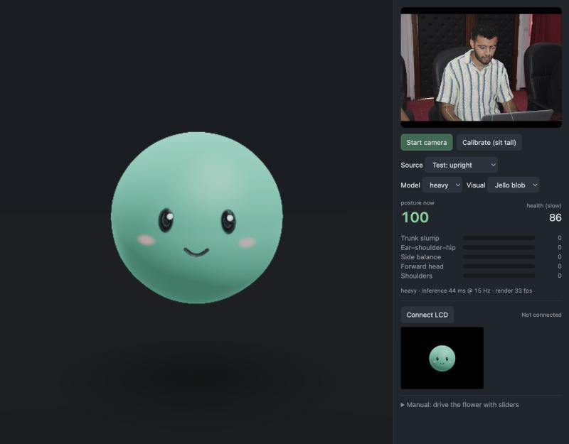
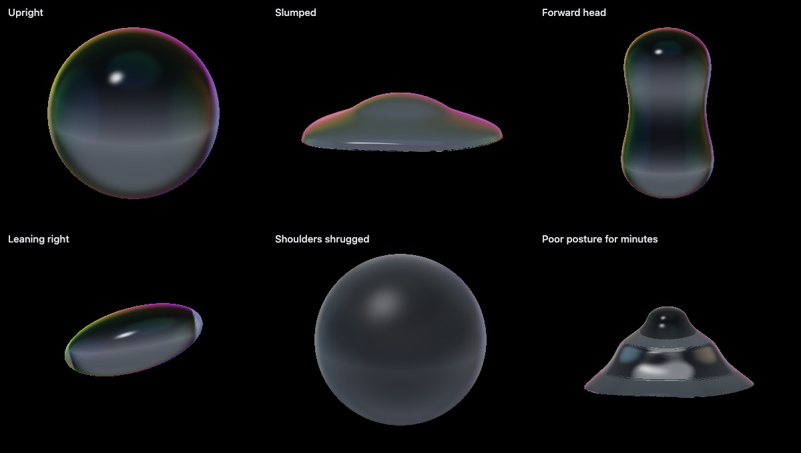
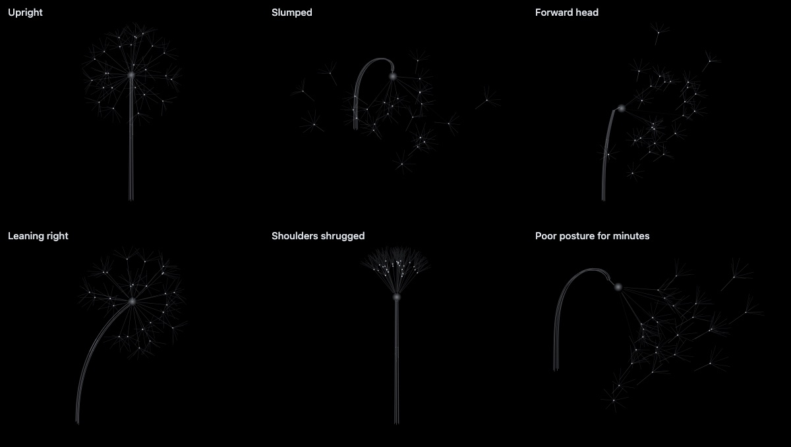
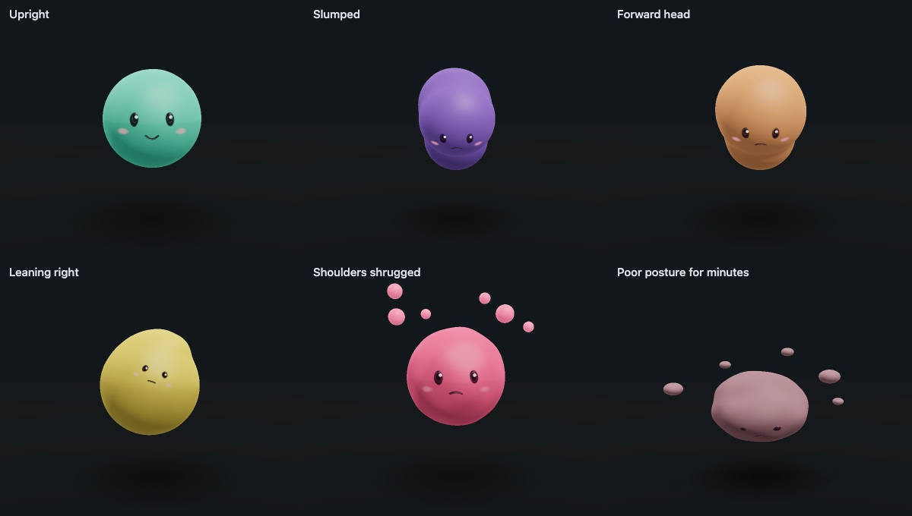

# Posture Buddy

Real-time sitting-posture tracking from a laptop's front webcam (MediaPipe Pose Landmarker, lite by default),
rendered as an animated artifact that mirrors your body: the EMA liquid metaball or dandelion, or a jello blob. The same
picture can stream to a Raspberry Pi's HDMI screen (or a small ESP32-S3 LCD).



| EMA: liquid metaball | EMA: dandelion | Jello blob |
|---|---|---|
|  |  |  |

Each grid shows the same six states: upright, slumped, forward head, leaning right, shoulders shrugged, and poor posture for minutes.

The EMA (Embodied Mindful Aesthetics) visuals are by Jihoon Park, from
[jihoonpark-mde/ema-visualization](https://github.com/jihoonpark-mde/ema-visualization) (private), ported into
`src/ema.js` with their rendering, motion and desk-time model unchanged. Each comes in two styles: liquid or contour-line
metaball, and single or branching dandelion. Their desk-time model adds a metaball (or seed cluster) for every 20 minutes
at the desk; in this app the camera frames the form as it is now, so it fills the screen from the first minute.

## Run

No build step: three.js and MediaPipe load from a CDN. Serve the folder and open it in Chrome:

```bash
python3 serve.py
```

(`serve.py` is `python3 -m http.server 8785` that tells the browser to recheck files on each load, so edits show up.)

Open http://localhost:8785, press **Start camera**, sit tall, and press **Calibrate**.
Camera frames stay in the browser. The MediaPipe library does send usage metrics to Google (see its README).

Pick a visual from the **Visual** dropdown (EMA liquid metaball by default); the external screen follows the choice, and
it's remembered.

URL options: `?visual=ema-liquid|ema-contour|ema-dandelion|ema-branching|blob`, `?model=lite|full|heavy` (lite is the default; heavy is more accurate but slower, and calibration is kept per model), `?hz=15` (inference rate), `?studymin=22` (study session length, shorten for a dry run),
`?src=front-man&autocal=1` (run on a test photo instead of the webcam),
`?display=pi|esp32`, `?pi=10.12.194.1` (the Pi's address), `?connect=1` (connect to the Pi on load), `?dispfps=30`,
`?mainfps=30` (this window's frame rate while streaming), `?flip=none|v|h|both` (stream orientation), `?zoom=1.5` (a fixed framing for the external screen instead of the automatic one).
`bench.html` benchmarks the three models on the test photos.

## Hosted version

https://posture-buddy.pages.dev (Cloudflare Pages, free plan) runs the visuals, live posture tracking and study sessions
in Chrome with no setup. Study recordings are saved to Cloudflare (a D1 database, `posture-study`), protected by a
**study key**. The Raspberry Pi screen still needs the local app (`python3 serve.py`), because browsers block an https
page from reaching the Pi's local address; the local app can save study data to Cloudflare too.

**Study storage** (Study panel → **Save to**):
- **Cloudflare** (default): enter the study key once per browser. Works from the hosted site and the local app, so a
  session that drives the Pi screen still lands in the cloud. **Download** saves a participant's files.
- **This Mac (data/)**: only from the local app; files go to `data/<participant>/`.

**Setting the study key** (once, by you; it's never in the code). Choose a long passphrase and run, then type it when asked:

```bash
PATH=/usr/local/opt/node@20/bin:$PATH npx --yes wrangler@3 pages secret put STUDY_KEY --project-name posture-buddy
```

Then run `./deploy.sh` once so the site picks it up. Share the key only with researchers; changing it the same way
locks out old copies.

**Publishing the latest commit:** `./deploy.sh` (uploads committed files only, never `data/`; `./deploy.sh --dev` runs
the same site and API locally with a test database). The API is `functions/api/data/[[path]].js`; the database and
project are in `wrangler.toml`.

## Layout

| file | role |
|---|---|
| `src/pose.js`, `src/pose-worker.js` | PoseLandmarker (VIDEO mode, GPU delegate), run in a worker so it doesn't hold up the page |
| `src/posture.js` | landmarks → frontal features → One Euro filter → calibrated severities |
| `src/pipeline.js` | what the artifact shows: ignores stretching, reaching, quick movement and absences; 4 s held posture; display health |
| `src/study.js` | study sessions: landmark recording, re-scoring recordings against a calibration, CSV and summary output |
| `data/` | study recordings and results, one folder per participant (not in git) |
| `src/visuals.js` | registry of visuals for the **Visual** dropdown; only the selected one is loaded |
| `src/ema.js` | EMA visuals (liquid/contour metaball, single/branching dandelion), by Jihoon Park; framed to the form's current size |
| `src/blob.js` | raymarched jello blob (same `setTarget` contract); main view capped at 0.3 MP to keep it fast |
| `src/display.js` | renders the selected visual's view for an external screen and streams it as JPEG frames: WebSocket to the Pi, or Web Serial to the ESP32 |
| `src/main.js` | camera, calibration, inference timer, UI |
| `serve.py` | local web server that keeps the browser from running stale code, and saves study data to `data/` |
| `functions/api/data/` | the hosted study data API (Cloudflare Pages Function, D1 database), protected by the study key |
| `deploy.sh`, `wrangler.toml` | publish to Cloudflare Pages |
| `pi/` | Raspberry Pi screen: `posture_display.py` (receives frames), `screen.html` (full-screen page), `install.sh`, `kiosk.sh` |
| `esp32/PostureBuddy/` | Arduino sketch for the ESP32-S3 + ST7789 LCD |
| `esp32/lcd_test.py` | sends JPEG files to the board and reports frame rate (needs pyserial) |

## Posture study

Each participant does two 22-minute sessions while working on their laptop: one with the artifact **passive** (neutral,
only breathing, blinking and swaying, whatever their posture) and one **active** (mirroring their posture), in
counterbalanced order. Order A is passive → active, order B active → passive; the app suggests A for odd participant
numbers and B for even ones.

**Running a session** (researcher panel, top right):
1. Start the camera. Enter the participant ID (e.g. `P01`), check the order, pick session 1 or 2.
2. Press **Start session**, then **Participant view** to show only the artifact (Esc brings the panel back).
3. The app runs:
   - a 5 s **camera check** ("look at the screen and sit as you normally would"), in every session;
   - **calibration** ("sit tall") before the active session only, so a passive first session never mentions posture;
   - the **22-minute timer**. At the end it saves everything and says "Session complete".

   **End early** stops a session and keeps what was recorded.

**What's saved** in `data/<participant>/`:

| File | Contents |
|---|---|
| `session1.jsonl`, `session2.jsonl` | the tracked body landmarks, about 15 per second (no video), plus events: camera check, calibration, timer start and end |
| `calibration.json` | the participant's calibration, taken before their active session |
| `session1_scored.csv`, `session2_scored.csv` | one row per second of the 22 minutes: present, status (held, or why it was ignored), display health, the 4 s average and the held posture's score and metrics |
| `summary.json` | per session: seconds held, seconds ignored by reason, mean held score, seconds in poor posture, mean and final display health, and the camera check's view of the participant |

Scores always come from the recordings, re-scored against the participant's one calibration with the same code the
live display uses. So a passive first session is scored as soon as session 2 is calibrated, and **Re-score** redoes a
participant after any change to the settings in `src/pipeline.js`. Keep the laptop, chair and screen angle the same
between sessions: scores are relative to where the camera sees the participant, and the camera checks in
`summary.json` show if that changed.

**What the artifact shows:** the live posture (smoothed only by the One Euro filter), so it responds within seconds; the
blob's slow wellness is a 45 s average of the live score. The EMA visuals add their own gentle glide (about half-way in
4 s, settled in about 10 s).

**The study model** (`SETTINGS` in `src/pipeline.js`) runs alongside and is what the scored CSVs record every second;
it doesn't drive the artifact:
- **Ignored, and 2 s after while settling back:** out of view; stretching (a wrist above the head); reaching (a wrist
  out beyond the shoulders); moving quickly (head or shoulders moving fast, lunging toward or away from the screen).
  Nothing changes while a moment is ignored.
- **Held posture:** once the posture has been steady for 4 s, its 4 s average counts.
- **Poor posture** (held score below 0.85): display health falls linearly over time, faster the worse the posture
  (the worst posture takes it from full to empty in 5 minutes).
- **Good posture:** a quick jump (30% of what's missing, over 2 s), then a slow linear rise, faster the better the
  posture (perfect posture fills it from empty in 3 minutes).
- `PosturePipeline.target()` turns this into a posture × time view (the last poor posture, more strongly the longer
  it's held). It's kept as an option; the artifact uses `liveTarget()`.

The server only accepts data from this machine, and never overwrites a recording or calibration: an earlier file is
kept as `<name>.<time>.bak`.

## Raspberry Pi screen (HDMI)

The Mac still does the tracking and 3D rendering; the Pi only shows the frames, full screen on its HDMI display.
Frames are ~0.5-megapixel JPEGs (~7–9 KB each) sent over a WebSocket; the Pi's Chromium decodes and scales them on its
GPU. The screen page reports its size, so the frames match its shape (544×960 on a portrait 1080×1920 panel).

Every visual frames itself so it fills the screen without being cut off. The EMA visuals frame the form as it is now
(about three-quarters of the screen, easing as it changes; ~29 fps for the liquid metaball on a portrait screen). The
blob frames itself from its own geometry: up to 2× closer than its LCD framing while compact, widening in the same frame
whenever anything would come within 7.5% of an edge (checked frame by frame through sudden switches between extreme
postures, on the Pi and on the ESP32's 4:3 LCD); `?zoom=1.5` fixes the blob's shot instead.
Nothing needs installing on the Pi beyond Raspberry Pi OS with desktop (the server is standard-library Python).

**One-time setup on the Pi** (Raspberry Pi 5, Raspberry Pi OS Trixie with desktop):

1. Turn on USB gadget mode so the USB-C cable to the Mac also carries a network link. Either tick
   *Enable USB Gadget Mode* in Raspberry Pi Imager 2.0 when writing the card, or on the Pi run:
   ```bash
   sudo apt install rpi-usb-gadget && sudo rpi-usb-gadget on && sudo reboot
   ```
   Plug the Pi's USB-C port into the Mac. The Mac sees a new network adapter, and the Pi is at `10.12.194.1`.
   A Pi 5 powered only by a laptop port may be short of power; a powered USB-C hub between them helps.
2. Copy the `pi/` folder to the Pi and run `./install.sh` in it (no sudo needed). This runs `posture_display.py` as a
   user service (port 8790), opens the full-screen page when the desktop starts, and adds a labwc window rule
   (in `~/.config/labwc/rc.xml`) that parks and hides the mouse pointer when the page opens.
   ```bash
   scp -r pi <user>@10.12.194.1:posture-buddy/ && ssh <user>@10.12.194.1 posture-buddy/pi/install.sh
   ```

**Orientation:** projected from above (the screen reflected in glass), the picture is seen mirrored, so the stream is
flipped vertically by default. **Orientation** next to **Screen** offers Normal, Flip vertical, Flip horizontal and
Rotate 180°; the preview shows what's sent, and this window's own view is never flipped. **Brightness** (default 2×)
lifts faint and mid tones on the screen while keeping black black and never clipping white (`?bright=2`).

**Each time:** in the app on the Mac, set **Screen** to *Raspberry Pi (HDMI)*, check the address (`10.12.194.1` over
USB, or the Pi's name or IP on Wi-Fi) and press **Connect**. The status line shows the stream rate and how fast the Pi
draws. While streaming, this window's own view runs at 30 fps so the Pi's stream gets the GPU time.

Measured with a 2018 MacBook Pro (Intel UHD 630 graphics), the blob and the heavy model, streaming over the USB cable
to a Raspberry Pi 5 with a portrait 1080×1920 Waveshare screen: ~28–29 fps received, ~7 KB per frame, and the Pi's page
draws each frame in 3–5 ms.

## ESP32-S3 LCD (alternative)

The computer does all the tracking and 3D rendering; the board only decodes and displays.
Each frame is a ~3–6 KB JPEG sent over the USB cable. On an ESP32-S3 N16R8 + Waveshare 2" ST7789 it runs at
~32 fps for the blob (decode + draw 20–22 ms per frame); the page sends 20 fps. When the stream stops, the last frame stays on screen;
at power-on the screen shows "loading..." until the first frame arrives.

1. Wire the LCD: DIN→GPIO11, CLK→GPIO12, CS→GPIO10, DC→GPIO9, RST→GPIO8, VCC→3V3, GND→GND, BL→3V3.
2. Install the **LovyanGFX** and **JPEGDEC** libraries.
3. Open `esp32/PostureBuddy/PostureBuddy.ino`. Board: *ESP32S3 Dev Module*, USB CDC On Boot: *Enabled*,
   Flash Size: *16MB*, Partition Scheme: *16M Flash (3MB APP/9.9MB FATFS)*, PSRAM: *OPI PSRAM*. Upload.
4. In Chrome or Edge, set **Screen** to *ESP32 LCD*, press **Connect** and pick the "USB JTAG/serial debug unit" port.
   Close the Arduino Serial Monitor first; only one program can hold the port.

Command-line equivalent of step 3:

```bash
arduino-cli compile --upload -p /dev/cu.usbmodem14201 -b "esp32:esp32:esp32s3:CDCOnBoot=cdc,FlashSize=16M,PartitionScheme=app3M_fat9M_16MB,PSRAM=opi" esp32/PostureBuddy
```

The SPI clock is 80 MHz. If the image shows noise or wrong colours, set `SPI_HZ` to 40 MHz in the sketch.
`?display=esp32&dispfps=20` picks it from the URL.

## Body → visual

| posture dimension | frontal-camera signal | EMA liquid metaball | EMA dandelion | jello blob |
|---|---|---|---|---|
| Trunk slump / recline (spine ⟂ thighs) | shoulders sink + get nearer the camera | flows down into a puddle | stem hooks over, head hangs | curls into a bean and turns indigo / arches back and turns sky blue |
| Ear–shoulder–hip stack | hips aren't visible, so inferred from head + trunk | metaballs scatter | seeds drift away | (combined) |
| Side balance (weight) | shoulder-line tilt + sideways shift | leans and pours toward the lean | stem curves toward the lean | jelly pools to one side and tips over, turns lemon |
| Forward head | ear-above-shoulder height ÷ shoulder width shrinks; head grows relative to shoulders; 3D ear-vs-shoulder depth | pinched at the waist | head tips forward | top lobe swells and droops, turns amber; head roll tilts the face |
| Shoulders protracted / raised | 3D shoulder span narrows; shoulders rise relative to ears | frosted and milky | folds into a bud | droplets bud off and rise above it, turns pink |
| Sustained posture (45 s average) | — | — | — | floating and smiling → sinks, sags, goes dull, frowns |

Severities are relative to your calibration, not absolute angles; [docs/METRICS.md](docs/METRICS.md) explains each one.
Thresholds are in `TOLERANCE` in `src/posture.js`.

Test photos in `test-images/` (including the one in the screenshot above) are from Wikimedia Commons;
see [test-images/CREDITS.md](test-images/CREDITS.md).

## README images

`docs/shots.html?visual=ema-liquid`, `?visual=ema-dandelion` and `?visual=blob` draw the state grids. With the server running:

```bash
"/Applications/Google Chrome.app/Contents/MacOS/Google Chrome" --headless=new --hide-scrollbars --window-size=1200,680 --virtual-time-budget=30000 --screenshot=blob-states.png "http://localhost:8785/docs/shots.html?visual=blob"
```
