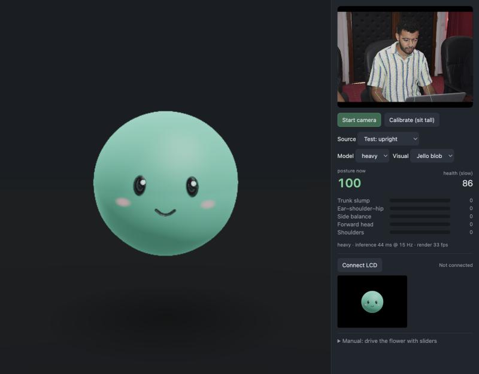
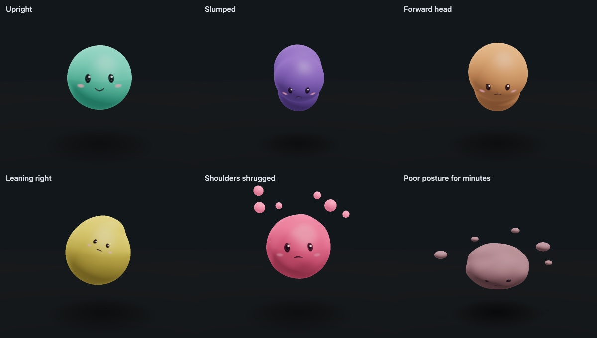

# Posture Flower

Real-time sitting-posture tracking from a laptop's front webcam (MediaPipe Pose Landmarker, heavy),
rendered as a 3D visual (three.js) that mirrors your body: a flower or a jello blob. The same picture can stream to a
Raspberry Pi's HDMI screen (or a small ESP32-S3 LCD).



| Flower | Jello blob |
|---|---|
|  |  |

Both grids show the same six states: upright, slumped, forward head, leaning right, shoulders shrugged, and poor posture for minutes.

## Run

No build step: three.js and MediaPipe load from a CDN. Serve the folder and open it in Chrome:

```bash
python3 serve.py
```

(`serve.py` is `python3 -m http.server 8785` that tells the browser to recheck files on each load, so edits show up.)

Open http://localhost:8785, press **Start camera**, sit tall, and press **Calibrate**.
Camera frames stay in the browser. The MediaPipe library does send usage metrics to Google (see its README).

Pick **Flower** or **Jello blob** from the **Visual** dropdown; the external screen follows the choice, and it's remembered.

URL options: `?visual=flower|blob`, `?model=heavy|full|lite`, `?hz=15` (inference rate), `?tau=45` (seconds for flower health to respond),
`?src=front-man&autocal=1` (run on a test photo instead of the webcam),
`?display=pi|esp32`, `?pi=10.12.194.1` (the Pi's address), `?connect=1` (connect to the Pi on load), `?dispfps=30`,
`?mainfps=30` (this window's frame rate while streaming), `?zoom=1.5` (a fixed framing for the external screen instead of the automatic one).
`bench.html` benchmarks the three models on the test photos.

## Layout

| file | role |
|---|---|
| `src/pose.js`, `src/pose-worker.js` | PoseLandmarker (VIDEO mode, GPU delegate), run in a worker so it doesn't hold up the page |
| `src/posture.js` | landmarks → frontal features → One Euro filter → calibrated severities |
| `src/visuals.js` | registry of visuals for the **Visual** dropdown; only the selected one is loaded |
| `src/flower.js` | procedural flower; springs on every parameter |
| `src/blob.js` | raymarched jello blob (same `setTarget` contract); main view capped at 0.3 MP to keep it fast |
| `blob-prototype/` | side-by-side flower vs. blob comparison page with presets and a state gallery |
| `src/display.js` | renders the selected visual's view for an external screen and streams it as JPEG frames: WebSocket to the Pi, or Web Serial to the ESP32 |
| `src/main.js` | camera, calibration, inference timer, UI |
| `serve.py` | local web server that keeps the browser from running stale code |
| `pi/` | Raspberry Pi screen: `posture_display.py` (receives frames), `screen.html` (full-screen page), `install.sh`, `kiosk.sh` |
| `esp32/FlowerStream/` | Arduino sketch for the ESP32-S3 + ST7789 LCD |
| `esp32/lcd_test.py` | sends JPEG files to the board and reports frame rate (needs pyserial) |

## Raspberry Pi screen (HDMI)

The Mac still does the tracking and 3D rendering; the Pi only shows the frames, full screen on its HDMI display.
Frames are ~0.5-megapixel JPEGs (~7–9 KB each) sent over a WebSocket; the Pi's Chromium decodes and scales them on its
GPU. The screen page reports its size, so the frames match its shape (544×960 on a portrait 1080×1920 panel).

The shot frames itself every frame from the visual's own geometry (the blob's spheres, every vertex of the flower):
up to 2× closer than the LCD framing while the visual is compact, widening in the same frame whenever anything would
come within 7.5% of an edge, then easing back in. Nothing is ever cut off: checked frame by frame through sudden
switches between extreme postures, nothing came closer than that margin, on the Pi and on the ESP32's 4:3 LCD.
`?zoom=1.5` fixes the shot instead.
Nothing needs installing on the Pi beyond Raspberry Pi OS with desktop (the server is standard-library Python).

**One-time setup on the Pi** (Raspberry Pi 5, Raspberry Pi OS Trixie with desktop):

1. Turn on USB gadget mode so the USB-C cable to the Mac also carries a network link. Either tick
   *Enable USB Gadget Mode* in Raspberry Pi Imager 2.0 when writing the card, or on the Pi run:
   ```bash
   sudo apt install rpi-usb-gadget && sudo rpi-usb-gadget on && sudo reboot
   ```
   Plug the Pi's USB-C port into the Mac. The Mac sees a new network adapter, and the Pi is at `10.12.194.1`.
   A Pi 5 powered only by a laptop port may be short of power; a powered USB-C hub between them helps.
2. Copy the `pi/` folder to the Pi and run `./install.sh` in it (no sudo needed). This runs `posture_display.py` as a
   user service (port 8790), opens the full-screen page when the desktop starts, and adds a labwc window rule
   (in `~/.config/labwc/rc.xml`) that parks and hides the mouse pointer when the page opens.
   ```bash
   scp -r pi <user>@10.12.194.1:posture-flower/ && ssh <user>@10.12.194.1 posture-flower/pi/install.sh
   ```

**Each time:** in the app on the Mac, set **Screen** to *Raspberry Pi (HDMI)*, check the address (`10.12.194.1` over
USB, or the Pi's name or IP on Wi-Fi) and press **Connect**. The status line shows the stream rate and how fast the Pi
draws. While streaming, this window's own view runs at 30 fps so the Pi's stream gets the GPU time.

Measured with a 2018 MacBook Pro (Intel UHD 630 graphics), the blob and the heavy model, streaming over the USB cable
to a Raspberry Pi 5 with a portrait 1080×1920 Waveshare screen: ~28–29 fps received, ~7 KB per frame, and the Pi's page
draws each frame in 3–5 ms.

## ESP32-S3 LCD (alternative)

The computer does all the tracking and 3D rendering; the board only decodes and displays.
Each frame is a ~3–6 KB JPEG sent over the USB cable. On an ESP32-S3 N16R8 + Waveshare 2" ST7789 it runs at
~28 fps for the flower and ~32 fps for the blob (decode + draw 20–22 ms per frame); the page sends 20 fps. When the stream stops, the last frame stays on screen;
at power-on the screen shows "waiting for Posture Flower" until the first frame arrives.

1. Wire the LCD: DIN→GPIO11, CLK→GPIO12, CS→GPIO10, DC→GPIO9, RST→GPIO8, VCC→3V3, GND→GND, BL→3V3.
2. Install the **LovyanGFX** and **JPEGDEC** libraries.
3. Open `esp32/FlowerStream/FlowerStream.ino`. Board: *ESP32S3 Dev Module*, USB CDC On Boot: *Enabled*,
   Flash Size: *16MB*, Partition Scheme: *16M Flash (3MB APP/9.9MB FATFS)*, PSRAM: *OPI PSRAM*. Upload.
4. In Chrome or Edge, set **Screen** to *ESP32 LCD*, press **Connect** and pick the "USB JTAG/serial debug unit" port.
   Close the Arduino Serial Monitor first; only one program can hold the port.

Command-line equivalent of step 3:

```bash
arduino-cli compile --upload -p /dev/cu.usbmodem14201 -b "esp32:esp32:esp32s3:CDCOnBoot=cdc,FlashSize=16M,PartitionScheme=app3M_fat9M_16MB,PSRAM=opi" esp32/FlowerStream
```

The SPI clock is 80 MHz. If the image shows noise or wrong colours, set `SPI_HZ` to 40 MHz in the sketch.
`?display=esp32&dispfps=20` picks it from the URL.

## Body → visual

| posture dimension | frontal-camera signal | flower | jello blob |
|---|---|---|---|
| Trunk slump / recline (spine ⟂ thighs) | shoulders sink + get nearer the camera | stem bends forward/back as a C-curve | curls into a bean and turns indigo / arches back and turns sky blue |
| Ear–shoulder–hip stack | hips aren't visible, so inferred from head + trunk | (combined) | (combined) |
| Side balance (weight) | shoulder-line tilt + sideways shift | stem leans, pot tips | jelly pools to one side and tips over, turns lemon |
| Forward head | ear-above-shoulder height ÷ shoulder width shrinks; head grows relative to shoulders; 3D ear-vs-shoulder depth | top of stem nods, bloom droops; head roll tilts the bloom | top lobe swells and droops, turns amber; head roll tilts the face |
| Shoulders protracted / raised | 3D shoulder span narrows; shoulders rise relative to ears | leaves swing forward / lift and tremble | droplets stretch out in front / drift up off the top, turns pink |
| Sustained posture (45 s average) | — | petals open and pink → closed, brown, drooping | floating and smiling → sinks, sags, goes dull, frowns |

Severities are relative to your calibration, not absolute angles; [docs/METRICS.md](docs/METRICS.md) explains each one.
Thresholds are in `TOLERANCE` in `src/posture.js`.

Test photos in `test-images/` (including the one in the screenshot above) are from Wikimedia Commons;
see [test-images/CREDITS.md](test-images/CREDITS.md).

## README images

`docs/shots.html?visual=flower` and `?visual=blob` draw the state grids. With the server running:

```bash
"/Applications/Google Chrome.app/Contents/MacOS/Google Chrome" --headless=new --hide-scrollbars --window-size=1200,680 --virtual-time-budget=30000 --screenshot=blob-states.png "http://localhost:8785/docs/shots.html?visual=blob"
```
